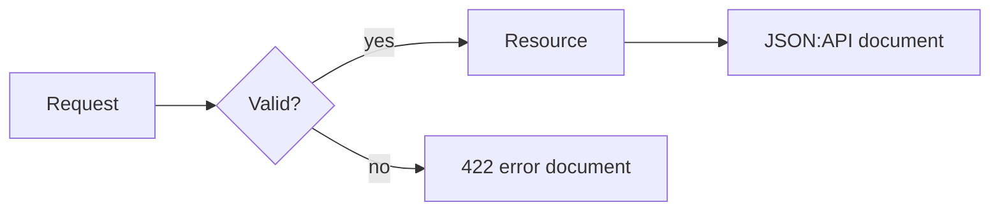

# Components

Two families are available in every page, written with MDC syntax (`::block` … `::`, `:inline{prop="…"}`).

## ark4ne components (from the portal)

| Component | Use |
|---|---|
| `::install` / `::install{dev}` | The Composer command, from `lib.yml`. Use it on the installation page instead of writing the package name. |
| `::compatibility` | The support table from `lib.yml`. Use it in the introduction. |
| `::example{input="…" output="…"}` with `#input` and `#output` slots | What you write, then what you get, stacked at full width in one card: a resource and its JSON, a form request and the generated `requestBody`. `input` titles the input panel: give the file name (`app/Http/Requests/StoreUser.php`) or the method (`BookResource::toArray()`); `output` names what is produced (`requestBody`, `components.schemas.Book`). Add `side` only for a short pair whose lines all fit in about 45 characters: it puts the two panels next to each other on wide screens. The heart of a guide. |
| `::http-call{method="…" url="…" status="…"}` with optional `#request` and `#response` slots | An HTTP call and what it answers, stacked at full width: the request line (one query parameter per line), its headers (`:headers='{"Api-Revision":"winter-25"}'`), its body, then the status and the response body. Use it for every request a client sends, never `::example` nor a `http` code block. `status` is a code (`422`: the reason phrase is added) or a label (`$request->validated()`). |
| `:since{v="1.2"}` | Inline badge for something added after the major's first release; put it at the end of a heading or a sentence. |
| `:lib-card{slug="openapi-writer"}` | A card to another ark4ne library, with its tagline and version. |

```md
::example{input="app/Http/Requests/StoreUser.php" output="components.schemas.StoreUser"}
#input
```php
'email' => ['required', 'email', 'max:255'],
```
#output
```json
{ "type": "string", "format": "email", "maxLength": 255 }
```
::
```

```md
::http-call{method="POST" url="/orders?include=lines" :headers='{"Api-Revision":"winter-25"}' status="422"}
#request
```json
{ "title": "Lamp", "state": "lost" }
```
#response
```json
{ "message": "The selected state is invalid." }
```
::
```

## Nuxt UI prose components

The theme is Nuxt UI; its prose components are available as is:

| Component | Use |
|---|---|
| `::note`, `::tip`, `::warning`, `::caution` | Callouts. One per idea; do not stack them. |
| `::code-group` | Several code blocks as tabs (e.g. PHP 8.3 / 8.4, controller / route). Give each block a label: ` ```php [Controller] `. |
| `::steps{level="3"}` | Numbered procedure built from the `###` headings inside it. Installation, migrations. |
| `::tabs` / `:::tabs-item{label="…"}` | Alternatives that are not code. |
| `::card-group` / `:::card{title="…" icon="…" to="…"}` | Feature lists, entry points. |
| `::field-group` / `:::field{name="…" type="…" required}` | Options, configuration keys, attribute parameters: the reference pages. |
| `::accordion` / `:::accordion-item{label="…"}` | FAQ, rarely needed details. |
| `::code-tree` | A small file tree with contents. |
| `::collapsible` | Long output that most readers skip. |
| `:badge[…]`, `:kbd{value="…"}`, `:icon{name="…"}` | Inline. |

## Diagrams

A `mermaid` code block becomes a diagram, themed like the rest of the portal (light/dark, the library's
accent). The text in brackets is its caption:

````md

````

- Use one when a flow, a sequence or a model is clearer drawn than told: the request lifecycle, which class
  calls which, the states of a revision. Not to decorate a page, and not for what a table says as well.
- Keep it small: a handful of nodes, short labels. Split a large one.
- Flowchart, sequence, class, state and ER diagrams follow the theme. Do not set colours, styles or a
  `theme` in the diagram: the portal owns the look.
- The Markdown source stays in `/raw/…md` and `llms-full.txt`, so agents read the diagram as text.
- `pnpm check` parses every diagram; an invalid one would show as an error box on the page.

Code blocks: always a language, and a file name when there is one: ` ```php [app/Models/User.php] `.
Highlighted languages: php, json, yaml, bash, shell, diff, ts, js, vue, html, ini, sql, xml, blade.

PHP lines are at most 80 columns (the fence's own indentation in a list or a slot does not count), so the
code fits the content column and the panels of `::example` and `::http-call` without scrolling. Wrap by
hand, PSR-12 style: one argument per line for long calls, signatures and attributes; break chains before
each `->`; one entry per line for arrays; a long trailing comment goes on its own line above. Example
values may be shortened (`example.com`) to fit. `pnpm check` fails on a longer line.
