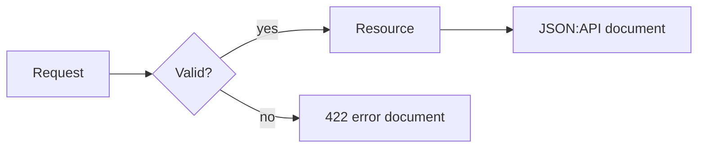

Guides are task-oriented and specific to the library: their titles, number and order are free.

## A step :since{v="2.1"}

::code-group
```php [Controller]
return UserResource::make($user);
```
```php [Route]
Route::get('/users/{user}', ShowUser::class);
```
::

## How it works

A diagram is a `mermaid` code block; the text in brackets is its caption.


